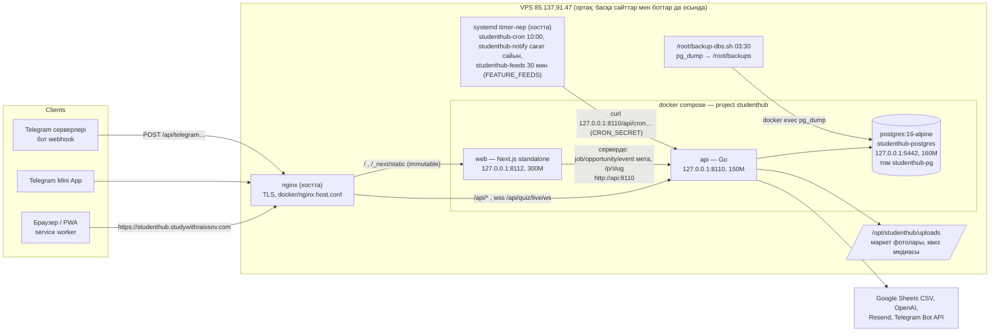

# Архитектура

## Сұраныс жолдары

| Сұраныс | Жолы | Ескерту |
| --- | --- | --- |
| `/`, `/search`, `/calendar`, `/profile`, барлық таб | nginx → web | build кезінде жасалған HTML/RSC (`●` SSG), сервер есептемейді |
| `/_next/static/*` | nginx → web | fingerprint-ті файлдар, `Cache-Control: immutable`, 1 жыл |
| фид (`GET /api/content`) | браузер → nginx → api | браузерде кэш: жад + localStorage, фонда жаңарады |
| `/api/*` (аккаунт, квиз, іс-шара, маркет, …) | nginx → api | Next арқылы өтпейді (rewrite тек dev/test үшін) |
| квиз live | `wss://<сайт>/api/quiz/live/ws` → api | бір origin; URL-ды сервер береді (`wsUrl`), болмаса `window.location` |
| `/job/<id>`, `/opportunity/<id>`, `/event/<id>`, `/p/<slug>` | nginx → web → api | серверде: превью мета-тегтері, жоқ болса redirect/404 |
| Telegram webhook | Telegram → nginx → api `/api/telegram` | ауысу кезінде ескі `studenthub.85-137-91-47.sslip.io` хосты да жұмыс істейді |
| күнделікті еске салу, digest | systemd timer → `127.0.0.1:8110/api/cron*` | Compose-тан тыс, қосымша жадсыз; `Persistent=true` өткізіп алғанын қуады |

## Неге осылай

- **Статикалық қабық.** Бұрын `app/layout.tsx` `force-dynamic` + `connection()` + `getContent()` әр сұраныста
  серверде орындалатын, сондықтан әр таб басу 0,5–5 с күтетін. Енді layout пен `[[...slug]]` толығымен
  статикалық; деректі браузер өзі алады. Offline: service worker беттерді сақтайды (`frontend/public/sw.js`),
  фидтің соңғы көшірмесі localStorage-та (`studenthub.content.v1`).
- **Тура `/api`.** nginx `/api/` пен WebSocket-ті Go-ға өзі жібереді: Next арқылы қосымша hop жоқ, cookie
  first-party, CSP `connect-src 'self' wss://<сайт>`.
- **Хосттағы nginx.** VPS-те nginx басқа сайттарға да қызмет етеді, сондықтан SIVA nginx контейнерін
  қоспайды; сервистер тек `127.0.0.1`-ге байланған.
- **Postgres сол томда.** Compose бұрынғы `docker run` контейнерінің атын (`studenthub-postgres`), image-ін,
  портын және `studenthub-pg` томын (`external: true`) қолданады — дерек көшірілмейді, жоғалмайды.
- **Timer-лер хостта.** Олар бұрыннан `curl 127.0.0.1:8110` жасайды, ал api контейнері сол портта. Бөлек cron
  контейнері жад алар еді және systemd-дің `Persistent=true` (сервер өшіп тұрса, кейін орындау) мүмкіндігі жоқ.

## Жад бюджеті (ортақ VPS)

| Сервис | Шек | Іс жүзінде (жергілікті өлшеу, бос жүктеме) |
| --- | --- | --- |
| postgres | 160M (`shared_buffers=24MB`, `max_connections=20`) | ~46 MiB |
| api | 150M (`GOMEMLIMIT=120MiB`) | ~20 MiB |
| web | 300M (`--max-old-space-size=192`) | ~51 MiB |
